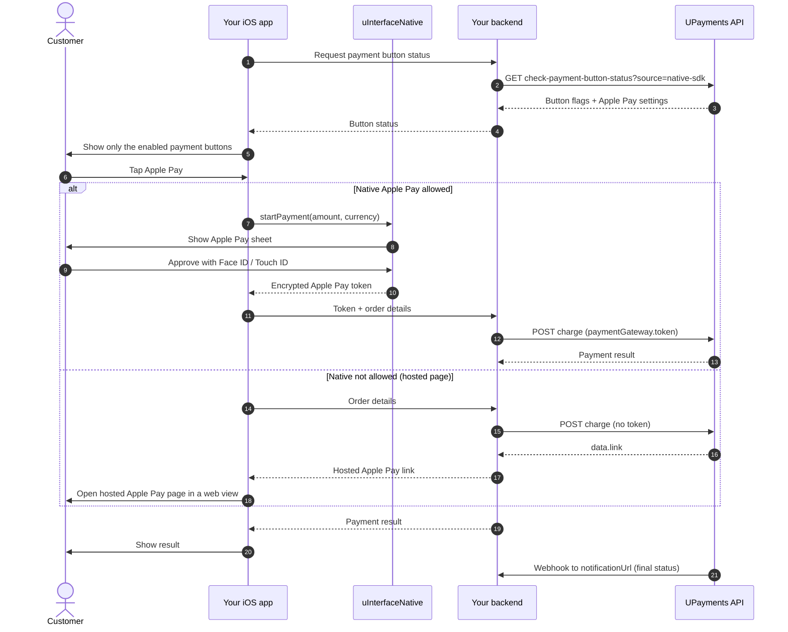

# uInterfaceNative: Native Apple Pay for UPayments API Merchants (iOS)

This guide is for merchants who **already call the UPayments REST API directly** (without `uInterfaceSDK`) and want to add the **native Apple Pay sheet** to their iOS app.

`uInterfaceNative` shows the Apple Pay sheet and gives you the encrypted Apple Pay token. You then send that token to the UPayments **charge** API, the same API you already use for other payments.

> If you are starting a new integration, consider the full `uInterfaceSDK` instead. It does all the steps below for you.

---

## Table of Contents

1. [How It Works](#1-how-it-works)
2. [When Can a Merchant Use the Native Apple Pay Sheet?](#2-when-can-a-merchant-use-the-native-apple-pay-sheet)
3. [Requirements](#3-requirements)
4. [One-Time Setup](#4-one-time-setup)
5. [Installation](#5-installation)
6. [Step 1: Check Payment Button Status (`source=native-sdk`)](#6-step-1-check-payment-button-status-sourcenative-sdk)
7. [Step 2: Decide Which Buttons to Show](#7-step-2-decide-which-buttons-to-show)
8. [Step 3: Build the Apple Pay Configuration](#8-step-3-build-the-apple-pay-configuration)
9. [Step 4: Show the Apple Pay Sheet and Get the Token](#9-step-4-show-the-apple-pay-sheet-and-get-the-token)
10. [Step 5: Charge the Token](#10-step-5-charge-the-token)
11. [Step 6: Confirm the Payment](#11-step-6-confirm-the-payment)
12. [Fallback: Hosted Apple Pay Page (Native Not Allowed)](#12-fallback-hosted-apple-pay-page-native-not-allowed)
13. [Error Handling](#13-error-handling)
14. [Testing](#14-testing)
15. [Go-Live Checklist](#15-go-live-checklist)
16. [API Reference](#16-api-reference)
17. [FAQ](#17-faq)

---

## 1. How It Works



If Apple Pay is disabled for your account, don't show the Apple Pay button at all (see [section 2](#2-when-can-a-merchant-use-the-native-apple-pay-sheet)).

**What `uInterfaceNative` does:** builds the Apple Pay request, shows the sheet, handles Face ID / Touch ID, and returns the token as a typed Swift model.

**What it does _not_ do:** it makes **no network calls**. Every call to the UPayments API in the chart above is made by your backend.

> [!IMPORTANT]
> Keep your UPayments API key on your **backend**. Your app should talk to your backend, and your backend calls UPayments. Never ship your API key inside the app.

---

## 2. When Can a Merchant Use the Native Apple Pay Sheet?

The native Apple Pay sheet is allowed only when **all** of these are true:

1. Your merchant account is **whitelabel** (set by UPayments).
2. UPayments has allowed **Apple Pay native** for your account.
3. **Apple Pay** or **Apple Pay KNET** is enabled in the merchant portal (**Upay Merchants App**).

You read all of this from the [button status API](#6-step-1-check-payment-button-status-sourcenative-sdk). What you do depends on the result:

| Button status result                                                             | What to do                                                                                                                                                            |
| :------------------------------------------------------------------------------- | :-------------------------------------------------------------------------------------------------------------------------------------------------------------------- |
| Apple Pay **and** Apple Pay KNET are both disabled                               | **Don't show** an Apple Pay button. If you still send an Apple Pay charge, UPayments returns an error.                                                                |
| Apple Pay is enabled, but native isn't allowed (or the account isn't whitelabel) | Show the Apple Pay button, but use the**[hosted Apple Pay page](#12-fallback-hosted-apple-pay-page-native-not-allowed)** in a web view. Don't use `uInterfaceNative`. |
| All three conditions are met                                                     | Use**`uInterfaceNative`** to show the native sheet (steps 3–6).                                                                                                       |

> [!IMPORTANT]
> Always call the button status API **before** you show the Apple Pay button, or **any** other payment button. Show only the methods it says are enabled.

---

## 3. Requirements

- iOS 13.0+
- Xcode 14+ and Swift 5.3+
- A working UPayments API integration (API key, charge API, webhook)
- An Apple Developer Program account

---

## 4. One-Time Setup

### 4.1 Apple Developer account

1. In the [Apple Developer portal](https://developer.apple.com/account), go to **Certificates, Identifiers & Profiles → Identifiers → Merchant IDs**.
2. Create a **Merchant ID**, e.g. `merchant.com.yourcompany.app`.
3. Open the Merchant ID → **Apple Pay Payment Processing Certificate → Create Certificate**, and upload the **CSR file you get from UPayments**. Send the issued certificate back to UPayments if they ask for it.
4. In Xcode, select your app target → **Signing & Capabilities → + Capability → Apple Pay**, and tick your Merchant ID.

> The Merchant ID must be the same one UPayments has on file for your account. Otherwise UPayments can't decrypt the token.

### 4.2 UPayments account

Ask UPayments to:

- enable **whitelabel** and **Apple Pay native** on your account, and
- enable **Apple Pay** and/or **Apple Pay KNET** in the merchant portal (Upay Merchants App).

---

## 5. Installation

Use Swift Package Manager (recommended) or the XCFramework.

### Swift Package Manager (recommended)

1. In Xcode: **File → Add Package Dependencies…**
2. Enter: `https://github.com/upaymentskwt/uinterface-native-ios-public.git`
3. Choose **Up to Next Major Version** and add the **uInterfaceNative** library to your app target.

Or in `Package.swift`:

```swift
dependencies: [
    .package(url: "https://github.com/upaymentskwt/uinterface-native-ios-public.git", from: "1.0.1")
],
targets: [
    .target(name: "YourApp", dependencies: [
        .product(name: "uInterfaceNative", package: "uinterface-native-ios-public")
    ])
]
```

### Manual (XCFramework)

Drag `uInterfaceNative.xcframework` into your target under **General → Frameworks, Libraries, and Embedded Content**, and set it to **Embed & Sign**.

---

## 6. Step 1: Check Payment Button Status (`source=native-sdk`)

Call this **every time** before you show the checkout screen. Your account settings can change at any time.

> [!IMPORTANT]
> You **must** send `source=native-sdk` as a query parameter. Without it, the response doesn't include the Apple Pay data (`nativeFlags`, `appleIdentifier`) that you need for the native sheet.

**Request (from your backend):**

```bash
curl -X GET "https://sandboxapi.upayments.com/api/v1/check-payment-button-status?source=native-sdk" \
  -H "Authorization: Bearer YOUR_API_KEY" \
  -H "x-api-key: YOUR_API_KEY" \
  -H "Accept: application/json"
```

Use the same authentication headers your existing UPayments API integration already uses.

| Environment | Base URL                                   |
| :---------- | :----------------------------------------- |
| Sandbox     | `https://sandboxapi.upayments.com/api/v1/` |
| Production  | `https://api.upayments.com/api/v1/`        |

**Response:**

```json
{
  "status": true,
  "message": "Data received successfully",
  "data": {
    "payButtons": {
      "knet": true,
      "cc": true,
      "apple-pay": true,
      "apple-pay-knet": true,
      "apple-native": true,
      "samsung-pay": false,
      "google-pay": false,
      "amex": false
    },
    "nativeFlags": {
      "applePay": "enabled",
      "merchantCapabilities": [
        "supports3DS",
        "supportsCredit",
        "supportsDebit"
      ],
      "supportedNetworks": ["visa", "masterCard", "mada"],
      "supportedCountries": ["KW"]
    },
    "appleIdentifier": {
      "merchantIdentifier": "merchant.com.yourcompany.app",
      "displayName": "Your Store Name",
      "countryCode": "KWT"
    },
    "isWhiteLabel": true
  }
}
```

| Field                                                               | Meaning                                                                                           |
| :------------------------------------------------------------------ | :------------------------------------------------------------------------------------------------ |
| `payButtons`                                                        | Which payment methods are enabled.`apple-pay` / `apple-pay-knet` are set in the merchant portal.  |
| `payButtons["apple-native"]` or `nativeFlags.applePay == "enabled"` | UPayments allows the**native** Apple Pay sheet. Either one is enough.                             |
| `isWhiteLabel`                                                      | Your account is whitelabel. Required for the native sheet.                                        |
| `nativeFlags.supportedNetworks`                                     | Card networks to accept in the sheet.                                                             |
| `nativeFlags.merchantCapabilities`                                  | 3DS / credit / debit support for the sheet.                                                       |
| `nativeFlags.supportedCountries`                                    | Card issuer countries to accept (optional).                                                       |
| `appleIdentifier.countryCode`                                       | Your merchant country. It may be 3 letters (`KWT`); convert it to 2 letters (`KW`) for Apple Pay. |

> [!NOTE]
> List fields may arrive as a JSON array (`["visa"]`) **or** as a JSON-encoded string (`"[\"visa\"]"`). The parsing code below handles both.

### Swift models for the response

Your backend can pass the UPayments response through to the app unchanged. Decode it in the app like this:

```swift
import Foundation

struct ButtonStatusResponse: Decodable {
    let status: Bool?
    let message: String?
    let data: ButtonStatusData?
}

struct ButtonStatusData: Decodable {
    let payButtons: [String: Bool]?
    let nativeFlags: NativeFlags?
    let appleIdentifier: AppleIdentifier?
    let isWhiteLabel: Bool?
}

struct AppleIdentifier: Decodable {
    let merchantIdentifier: String?
    let displayName: String?
    let countryCode: String?
}

struct NativeFlags: Decodable {
    let applePay: String?
    let merchantCapabilities: [String]
    let supportedNetworks: [String]
    let supportedCountries: [String]

    enum CodingKeys: String, CodingKey {
        case applePay, merchantCapabilities, supportedNetworks, supportedCountries
    }

    init(from decoder: Decoder) throws {
        let c = try decoder.container(keyedBy: CodingKeys.self)
        applePay = try c.decodeIfPresent(String.self, forKey: .applePay)
        merchantCapabilities = NativeFlags.list(c, .merchantCapabilities)
        supportedNetworks = NativeFlags.list(c, .supportedNetworks)
        supportedCountries = NativeFlags.list(c, .supportedCountries)
    }

    /// Accepts `["a","b"]`, `"[\"a\",\"b\"]"`, or `"a"`.
    private static func list(_ c: KeyedDecodingContainer<CodingKeys>, _ key: CodingKeys) -> [String] {
        if let array = try? c.decode([String].self, forKey: key) { return array }
        guard let string = try? c.decode(String.self, forKey: key) else { return [] }
        if let data = string.data(using: .utf8),
           let array = try? JSONDecoder().decode([String].self, from: data) { return array }
        return [string]
    }
}
```

---

## 7. Step 2: Decide Which Buttons to Show

```swift
enum ApplePayMode {
    case hidden    // Apple Pay disabled: don't show the button
    case hosted    // show the button, use the hosted Apple Pay page (section 12)
    case native    // show the button, use uInterfaceNative (steps 3–6)
}

extension ButtonStatusData {
    func isEnabled(_ key: String) -> Bool { payButtons?[key] ?? false }

    var isNativeAllowed: Bool {
        nativeFlags?.applePay?.lowercased() == "enabled" || isEnabled("apple-native")
    }

    var applePayMode: ApplePayMode {
        guard isEnabled("apple-pay") || isEnabled("apple-pay-knet") else { return .hidden }
        return (isWhiteLabel == true && isNativeAllowed) ? .native : .hosted
    }
}
```

Use it when building your checkout screen:

```swift
// `status` is the decoded ButtonStatusData from step 1
knetButton.isHidden = !status.isEnabled("knet")
cardButton.isHidden = !status.isEnabled("cc")
applePayButton.isHidden = status.applePayMode == .hidden
```

### Use Apple's Apple Pay button

Apple requires the official `PKPaymentButton` (App Store review checks this). Don't draw your own Apple Pay button:

```swift
import PassKit

let applePayButton = PKPaymentButton(paymentButtonType: .buy, paymentButtonStyle: .black)
applePayButton.addTarget(self, action: #selector(didTapApplePay), for: .touchUpInside)
// add it to your view and lay it out like any other button
```

Pick the `paymentButtonType` that fits your screen (`.buy`, `.checkout`, `.plain`, …) and a style that contrasts with your background (`.black`, `.white`, `.whiteOutline`, or `.automatic` on iOS 14+).

> [!TIP]
> In `.native` mode, also check that the device can use Apple Pay (step 4, `canMakePayments()`). If it can't, use the hosted page instead.

Which `src` to send to the charge API:

- Use `"apple-pay"` if `payButtons["apple-pay"]` is `true`.
- Otherwise use `"apple-pay-knet"`.

---

## 8. Step 3: Build the Apple Pay Configuration

You provide only **two** values yourself:

| Value                  | Where it comes from                                                       |
| :--------------------- | :------------------------------------------------------------------------ |
| `merchantIdentifier`   | **You**: your Apple Merchant ID from [setup](#41-apple-developer-account) |
| `merchantName`         | **You**: the name shown on the Apple Pay sheet                            |
| `countryCode`          | **API**: `appleIdentifier.countryCode` (converted to 2 letters)           |
| `supportedNetworks`    | **API**: `nativeFlags.supportedNetworks`                                  |
| `merchantCapabilities` | **API**: `nativeFlags.merchantCapabilities`                               |
| `supportedCountries`   | **API**: `nativeFlags.supportedCountries`                                 |

> [!WARNING]
> Don't hard-code the country, networks, or capabilities. UPayments controls them for your account, and they must match what UPayments can process. Always build them from the latest button status response.

Copy these helpers into your app. They turn the API values into what `uInterfaceNative` expects:

```swift
import PassKit
import uInterfaceNative

enum UPaymentsApplePayMapper {

    /// "visa" → .visa, "masterCard" → .masterCard, ...
    static func networks(_ names: [String]) -> [PKPaymentNetwork] {
        let mapped: [PKPaymentNetwork] = names.map { name in
            switch name.trimmingCharacters(in: .whitespaces).lowercased() {
            case "visa": return .visa
            case "mastercard": return .masterCard
            case "amex", "americanexpress": return .amex
            case "mada": return .mada
            case "discover": return .discover
            case "jcb": return .JCB
            case "chinaunionpay", "unionpay": return .chinaUnionPay
            case "maestro": return .maestro
            case "electron": return .electron
            case "vpay": return .vPay
            case "interac": return .interac
            default: return PKPaymentNetwork(rawValue: name)
            }
        }
        return mapped.isEmpty ? [.visa, .masterCard, .mada, .amex] : mapped
    }

    /// "supports3DS" → .capability3DS, "supportsCredit" → .capabilityCredit, ...
    static func capabilities(_ names: [String]) -> PKMerchantCapability {
        var result: PKMerchantCapability = []
        for name in names {
            switch name.trimmingCharacters(in: .whitespaces).lowercased() {
            case "supports3ds", "3ds": result.insert(.capability3DS)
            case "supportscredit", "credit": result.insert(.capabilityCredit)
            case "supportsdebit", "debit": result.insert(.capabilityDebit)
            case "supportsemv", "emv": result.insert(.capabilityEMV)
            default: break
            }
        }
        return result.isEmpty ? [.capability3DS, .capabilityCredit, .capabilityDebit] : result
    }

    /// "KWT" → "KW". Apple Pay needs a 2-letter ISO country code.
    static func countryCode(_ code: String?) -> String {
        let raw = (code ?? "").trimmingCharacters(in: .whitespaces).uppercased()
        let map = ["KWT": "KW", "SAU": "SA", "ARE": "AE", "QAT": "QA", "BHR": "BH", "OMN": "OM"]
        if let mapped = map[raw] { return mapped }
        return raw.count == 2 ? raw : "KW"
    }

    /// Builds the configuration from your two values plus the button status response.
    static func configuration(
        merchantIdentifier: String,
        merchantName: String,
        status: ButtonStatusData
    ) -> ApplePayConfiguration {
        let flags = status.nativeFlags
        let countries = Set((flags?.supportedCountries ?? []).map { $0.uppercased() })
        return ApplePayConfiguration(
            merchantIdentifier: merchantIdentifier,
            countryCode: countryCode(status.appleIdentifier?.countryCode),
            supportedNetworks: networks(flags?.supportedNetworks ?? []),
            merchantCapabilities: capabilities(flags?.merchantCapabilities ?? []),
            merchantName: merchantName,
            supportedCountries: countries.isEmpty ? nil : countries
        )
    }
}
```

The fallback values (Visa / Mastercard / mada / Amex; 3DS, credit, debit; `KW`) apply only if the API leaves a field empty.

---

## 9. Step 4: Show the Apple Pay Sheet and Get the Token

```swift
import uInterfaceNative

final class CheckoutViewController: UIViewController {

    // Keep a strong reference while the sheet is on screen.
    private var processor: ApplePayProcessor?

    func payWithApplePay(status: ButtonStatusData, orderId: String, amount: Double, currency: String) {
        let config = UPaymentsApplePayMapper.configuration(
            merchantIdentifier: "merchant.com.yourcompany.app",
            merchantName: "Your Store Name",
            status: status
        )
        let processor = ApplePayProcessor(configuration: config)
        self.processor = processor

        guard processor.canMakePayments() else {
            openHostedApplePay(orderId: orderId, amount: amount, currency: currency) // section 12
            return
        }

        processor.startPayment(
            amount: amount,          // e.g. 17.5
            currency: currency,      // 3-letter code, e.g. "KWD"
            summaryItems: [          // optional line items; the total is added for you
                ApplePaySummaryItem(label: "Wireless Headphones", amount: 15.0),
                ApplePaySummaryItem(label: "Shipping", amount: 2.5)
            ]
        ) { [weak self] result in
            // Always called on the main thread.
            self?.processor = nil
            switch result {
            case .success(let tokenPayload):
                self?.sendToBackend(tokenPayload: tokenPayload, orderId: orderId, amount: amount, currency: currency)
            case .failure(.userCancelled):
                break // customer closed the sheet; stay on checkout
            case .failure(let error):
                self?.showError(error.localizedDescription)
            }
        }
    }
}
```

What you get back (`ApplePayPaymentTokenPayload`):

| Property                | Description                                                                                                               |
| :---------------------- | :------------------------------------------------------------------------------------------------------------------------ |
| `paymentData`           | The**encrypted** Apple Pay token (`data`, `signature`, `version`, `header`). Only UPayments can decrypt it.               |
| `paymentMethod`         | Card info for display:`type` (`debit` / `credit` / `prepaid`), `network` (e.g. `Visa`), `displayName` (e.g. `Visa 1030`). |
| `transactionIdentifier` | Apple's ID for this authorization.                                                                                        |

> [!NOTE]
> The sheet shows a **success** tick as soon as the token is created, **before** UPayments charges it. Show the final result in your own UI after step 5.

---

## 10. Step 5: Charge the Token

`ApplePayPaymentTokenPayload` is `Codable`, and its JSON already matches what UPayments expects in `paymentGateway.token`. Encode it and send it to **your backend** together with the order details:

```swift
extension CheckoutViewController {
    func sendToBackend(tokenPayload: ApplePayPaymentTokenPayload, orderId: String, amount: Double, currency: String) {
        guard let tokenJSON = try? JSONEncoder().encode(tokenPayload),
              let token = try? JSONSerialization.jsonObject(with: tokenJSON) else { return }

        let body: [String: Any] = [
            "orderId": orderId,
            "amount": amount,
            "currency": currency,
            "src": "apple-pay",   // or "apple-pay-knet" (see step 2)
            "token": token
        ]

        var request = URLRequest(url: URL(string: "https://yourbackend.com/api/apple-pay/charge")!)
        request.httpMethod = "POST"
        request.setValue("application/json", forHTTPHeaderField: "Content-Type")
        request.httpBody = try? JSONSerialization.data(withJSONObject: body)
        URLSession.shared.dataTask(with: request) { data, _, error in
            DispatchQueue.main.async {
                // Show the result your backend returns (see "Charge response" below)
            }
        }.resume()
    }
}
```

**Your backend then calls UPayments `charge`:**

```bash
curl -X POST "https://sandboxapi.upayments.com/api/v1/charge" \
  -H "Authorization: Bearer YOUR_API_KEY" \
  -H "x-api-key: YOUR_API_KEY" \
  -H "Content-Type: application/json" \
  -H "Accept: application/json" \
  -d '{
    "order": { "id": "ORD_987654", "amount": 17.5, "currency": "KWD" },
    "paymentGateway": {
      "src": "apple-pay",
      "token": {
        "transactionIdentifier": "3369...7890",
        "paymentData": {
          "data": "t3xP...b7A==",
          "signature": "MIAG...AAAA==",
          "version": "EC_v1",
          "header": {
            "publicKeyHash": "rP8Y...4E0Ow=",
            "ephemeralPublicKey": "MFkw...95A==",
            "transactionId": "ab17...5cb8"
          }
        },
        "paymentMethod": { "type": "debit", "network": "Visa", "displayName": "Visa 1030" }
      }
    },
    "is_whitelabeled": true,
    "language": "en",
    "reference": { "id": "REF_987654" },
    "customer": { "name": "Sara Al-Ahmad", "email": "sara@example.com", "mobile": "96512345678" },
    "returnUrl": "https://yourdomain.com/payment/success",
    "cancelUrl": "https://yourdomain.com/payment/cancel",
    "notificationUrl": "https://yourdomain.com/payment/webhook"
  }'
```

- `paymentGateway.token`: send the token object **as JSON**, exactly as the app produced it. Don't modify it, and don't wrap it in a string.
- `paymentGateway.src`: `"apple-pay"` or `"apple-pay-knet"`. It is required for whitelabel accounts.
- `order.amount` and `order.currency` **must match** what the customer saw on the Apple Pay sheet.
- `order.id` and `reference.id` should be unique per payment.
- `language`, `reference.id`, `returnUrl`, `cancelUrl` and `notificationUrl` are required, the same as for your other charges.

### Charge response

The `status` field tells you whether the request was accepted. `data` holds the transaction details:

| `data` field                                                    | Meaning                                                                                                                                                                 |
| :-------------------------------------------------------------- | :---------------------------------------------------------------------------------------------------------------------------------------------------------------------- |
| `result`                                                        | `CAPTURED` / `SUCCESS` = paid · `DECLINED` · `FAILED` · `CANCELED`                                                                                                      |
| `track_id`                                                      | UPayments tracking ID (save it)                                                                                                                                         |
| `payment_id`, `tran_id`, `order_id`, `ref`, `auth`, `post_date` | Transaction references                                                                                                                                                  |
| `link`                                                          | If present, UPayments needs one more step (for example 3-D Secure). Open it in a web view like the[hosted page](#12-fallback-hosted-apple-pay-page-native-not-allowed). |

---

## 11. Step 6: Confirm the Payment

Before you ship goods or unlock content, confirm the payment **on your backend**:

- **Webhook (recommended):** UPayments sends the final status to your `notificationUrl`.
- **Status lookup:** `GET https://sandboxapi.upayments.com/api/v1/get-payment-status/{track_id}` with the same auth headers. Check `data.transaction.result`.

Never trust only the result shown in the app.

---

## 12. Fallback: Hosted Apple Pay Page (Native Not Allowed)

Use this when `applePayMode == .hosted`, or when the device can't show the native sheet:

1. Your backend calls `charge` with `"paymentGateway": { "src": "apple-pay" }` and **no `token`**. Use `"apple-pay-knet"` if only that is enabled.
2. The response contains `data.link`. Open it in a `WKWebView`; it shows UPayments' hosted Apple Pay screen.
3. When the web view tries to load your `returnUrl` or `cancelUrl`, close it. Read the result from the URL's query parameters (`result`, `track_id`, …).
4. Confirm the payment on your backend ([step 6](#11-step-6-confirm-the-payment)).

`uInterfaceNative` isn't used in this flow.

---

## 13. Error Handling

`startPayment` returns `ApplePayError` on failure. Every case has a readable `localizedDescription`.

| Error                          | Meaning                                                               | What to do                                                                  |
| :----------------------------- | :-------------------------------------------------------------------- | :-------------------------------------------------------------------------- |
| `.userCancelled`               | Customer closed the sheet                                             | Do nothing; let them choose again                                           |
| `.deviceNotSupported`          | Device can't use Apple Pay                                            | Use the[hosted page](#12-fallback-hosted-apple-pay-page-native-not-allowed) |
| `.noSupportedCards`            | No matching card in Wallet (only when`requiresActiveCards` is `true`) | Use the hosted page, or ask the customer to add a card                      |
| `.missingMerchantIdentifier`   | Empty Merchant ID                                                     | Check your configuration                                                    |
| `.invalidAmount(_)`            | Amount ≤ 0                                                            | Fix the amount                                                              |
| `.invalidCurrency(_)`          | Currency isn't a 3-letter code                                        | Use e.g.`"KWD"`                                                             |
| `.invalidCountryCode(_)`       | Empty country code                                                    | Check the`countryCode` mapping                                              |
| `.passKitError(_)`             | The sheet couldn't be shown (e.g. Apple Pay capability missing)       | Check Xcode**Signing & Capabilities**; fall back to the hosted page         |
| `.authorizationFailed(_)`      | Apple Pay authorization failed                                        | Show an error and let the customer retry                                    |
| `.tokenSerializationFailed(_)` | The token couldn't be read                                            | Retry; contact UPayments if it persists                                     |
| `.unknown(_)`                  | Anything else                                                         | Show a generic error                                                        |

Errors from the **charge API** come from UPayments, the same as for your other charges. Check `status` and `message` in the response.

---

## 14. Testing

- Use the **sandbox** base URL and your sandbox API key.
- **Test on a real iPhone** signed in with an [Apple Pay sandbox tester account](https://developer.apple.com/apple-pay/sandbox-testing/) and Apple's test cards.
- The **iOS Simulator** can show the sheet, but it returns a **placeholder token**, not a real one. A charge made with it won't succeed. Use the simulator only to test your UI.
- Test every mode: Apple Pay disabled (button hidden), native not allowed (hosted page), native allowed (sheet), and customer cancels.

---

## 15. Go-Live Checklist

- [ ] Production base URL (`https://api.upayments.com/api/v1/`) and production API key, kept on your backend only
- [ ] Button status API called with `source=native-sdk` before showing payment buttons
- [ ] Country, networks and capabilities come from the API, not hard-coded
- [ ] Merchant ID in Xcode matches the one registered with UPayments; Apple Pay Payment Processing Certificate is active
- [ ] Charge amount and currency match the Apple Pay sheet
- [ ] Hosted-page fallback works when native isn't allowed or the device can't use Apple Pay
- [ ] Orders are fulfilled only after the webhook or status lookup confirms payment
- [ ] Tested on a real device with a real card in production

---

## 16. API Reference

### `ApplePayConfiguration`

```swift
public init(
    merchantIdentifier: String,                       // yours
    countryCode: String = "KW",                       // from API: appleIdentifier.countryCode (2 letters)
    supportedNetworks: [PKPaymentNetwork] = [.visa, .masterCard, .mada, .amex], // from API
    merchantCapabilities: PKMerchantCapability = [.capability3DS, .capabilityDebit, .capabilityCredit], // from API
    merchantName: String? = nil,                      // yours (shown on the sheet)
    requiresActiveCards: Bool = false,                // true = fail with .noSupportedCards if Wallet has no matching card
    supportedCountries: Set<String>? = nil            // from API
)
```

### `ApplePayProcessor`

| Method                                                   | Description                                                                                                   |
| :------------------------------------------------------- | :------------------------------------------------------------------------------------------------------------ |
| `init(configuration:)`                                   | Creates a processor. Keep a strong reference until the completion is called.                                  |
| `canMakePayments() -> Bool`                              | `true` if the device supports Apple Pay.                                                                      |
| `canMakePaymentsWithActiveCards() -> Bool`               | `true` if Wallet has a card on one of `supportedNetworks`.                                                    |
| `startPayment(amount:currency:summaryItems:completion:)` | Shows the sheet. Completion runs on the main thread with`Result<ApplePayPaymentTokenPayload, ApplePayError>`. |
| `makePaymentRequest(amount:currency:summaryItems:)`      | Advanced: builds the`PKPaymentRequest` without showing it.                                                    |

### `ApplePaySummaryItem`

`ApplePaySummaryItem(label: String, amount: Double, type: PKPaymentSummaryItemType = .final)`, or use `decimalAmount: NSDecimalNumber` for exact values. If the last item's amount doesn't equal `amount`, a total line labelled with `merchantName` (or "Total") is added.

### `ApplePayPaymentTokenPayload` (`Codable`)

```text
transactionIdentifier: String?
paymentData:   { data, signature, version, header: { publicKeyHash, ephemeralPublicKey, transactionId, wrappedKey } }
paymentMethod: { type, network, displayName }
```

---

## 17. FAQ

**Why is `nativeFlags` missing from the button status response?**
You didn't send `?source=native-sdk`. Add it to the request.

**Can I call the button status API once and cache it?**
Call it each time the checkout screen opens. The merchant can change settings in the portal at any time.

**Can I call the UPayments API straight from the app?**
It works, but it puts your API key inside the app, where it can be extracted. Route calls through your backend.

**The sheet shows a success tick, but the payment failed.**
The tick only means Apple created the token. The charge happens in step 5. Show the charge result to the customer.

**Do I need `uInterfaceSDK` as well?**
No. `uInterfaceNative` works on its own. `uInterfaceSDK` is an optional, higher-level SDK that also handles the API calls.

---

**Support:** [developers.upayments.com](https://developers.upayments.com) · `support@upayments.com`
